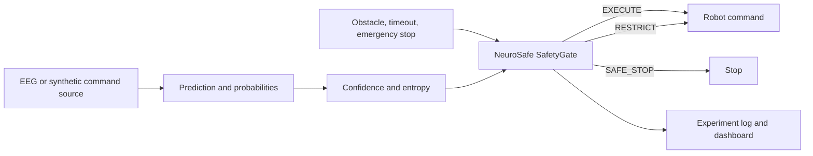

# System architecture

The prediction model never controls the robot directly. The SafetyGate receives both the
model output and robot safety context. Hard safety constraints override confidence.

## Decision policy

| Decision | Condition | Robot behaviour |
|---|---|---|
| EXECUTE | Confidence at or above execute threshold and all safety checks pass | Normal command |
| RESTRICT | Moderate confidence and all safety checks pass | Reduced-speed command |
| SAFE_STOP | Low confidence, high uncertainty, obstacle, timeout, invalid data, or emergency stop | Stop |

## Current boundaries

- The synthetic experiment validates software logic, not clinical safety.
- The first EEG model is subject-specific and uses public offline data.
- Cross-subject generalization, calibrated uncertainty, ROS2, Gazebo, and hardware are later milestones.

